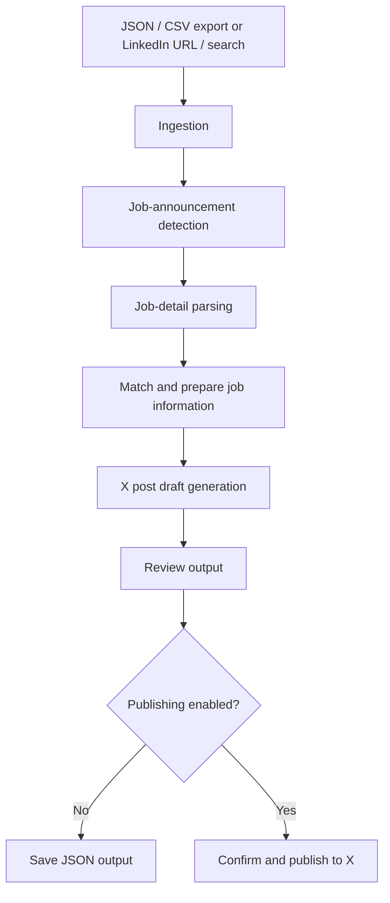

# LinkedIn-to-X Job Announcement Pipeline

A Python application that turns job-announcement posts into structured opportunity data and reviewable, X-ready drafts. It supports a command-line workflow and a Streamlit interface, with optional Gemini-powered extraction and an explicit publishing step.

> **Publishing is opt-in.** The CLI defaults to `--no-publish`; generated content can be reviewed before anything is posted.

## How it works



Gemini can assist with classification and structured extraction. A heuristic fallback and a no-LLM mode are also supported.

## Features

- Ingest posts from JSON and CSV files.
- Optional collection from a LinkedIn updates URL or search query.
- Detect whether a post describes a job opportunity.
- Extract structured job details using Gemini or heuristic fallbacks.
- Generate concise drafts intended for X.
- Save generated drafts as JSON.
- Run from either a Click-based CLI or a Streamlit UI.
- Keep publishing behind explicit configuration and confirmation.

## Tech stack

| Area | Tools |
|---|---|
| Language | Python 3.11+ |
| Interface | Streamlit |
| CLI | Click |
| LLM extraction | Google GenAI SDK |
| Validation and settings | Pydantic, Pydantic Settings |
| Browser automation | Playwright |
| X integration | Tweepy |
| Data handling | Pandas |
| Tests | pytest |
| CI | GitHub Actions |

## Project structure

```text
JT/
├── src/
│   ├── app.py                 # Streamlit interface
│   ├── cli/main.py            # Command-line entry point
│   ├── config/settings.py    # Application settings
│   ├── linkedin/
│   │   ├── ingest.py
│   │   ├── job_detector.py
│   │   ├── job_parser.py
│   │   ├── matcher.py
│   │   └── scraper.py
│   └── twitter/
│       ├── publisher.py
│       └── tweet_generator.py
├── tests/                     # Unit tests
├── .github/workflows/ci.yml   # GitHub Actions checks
├── .env.example
├── pyproject.toml
└── requirements.txt
```

## Getting started

### 1. Requirements

- Python 3.11 or newer
- Playwright Chromium for browser-based collection

### 2. Install

```bash
git clone https://github.com/VeerendraNambula/JT.git
cd JT

python -m venv .venv

# Windows
.venv\\Scripts\\activate

# macOS / Linux
source .venv/bin/activate

pip install -r requirements.txt
playwright install chromium
```

### 3. Configure environment

Copy `.env.example` to `.env` and set only the credentials needed for your workflow.

| Variable | Purpose |
|---|---|
| `GEMINI_API_KEY` | Optional; enables Gemini-powered classification and parsing |
| `DEFAULT_MODEL` | Gemini model name; example configuration uses `gemini-2.5-flash` |
| `X_API_KEY` | X API consumer key; needed for publishing |
| `X_API_SECRET` | X API consumer secret; needed for publishing |
| `X_ACCESS_TOKEN` | X user access token; needed for publishing |
| `X_ACCESS_TOKEN_SECRET` | X user access-token secret; needed for publishing |

Keep `.env` out of version control. Never place real API keys or tokens in source code, screenshots, issues, or commits.

## Run the application

### Command-line interface

See all available options:

```bash
python src/cli/main.py --help
```

Process a local export and do not publish:

```bash
python src/cli/main.py --input-file posts.json --output-file tweets_output.json --no-publish
```

The CLI also exposes options for URL/search input, post limits, LLM enablement, browser mode, and interactive publishing confirmation. Use `--help` for the current option list.

### Streamlit interface

```bash
streamlit run src/app.py
```

## Tests and CI

Install the development extra and run the test suite:

```bash
pip install -e ".[dev]"
python -m compileall -q src tests
python -m pytest -q
```

GitHub Actions runs on pushes and pull requests to `main`. The workflow installs dependencies, compiles the Python modules, and runs pytest.

## Responsible use and limitations

- Collect and process only information you are authorized to access.
- Respect platform terms, privacy expectations, and rate limits.
- Treat extracted job details and generated drafts as suggestions; verify them against the original announcement.
- Review every draft before publishing. Keep automated publishing disabled unless you intentionally configure X credentials and enable it.
- Browser-based collection may be affected by changes to third-party websites.

## Project status

This repository demonstrates a modular Python workflow combining ingestion, classification, structured extraction, text generation, browser automation, and an optional publishing integration. It is a portfolio project; validate current platform access and API requirements before relying on it for ongoing production use.
